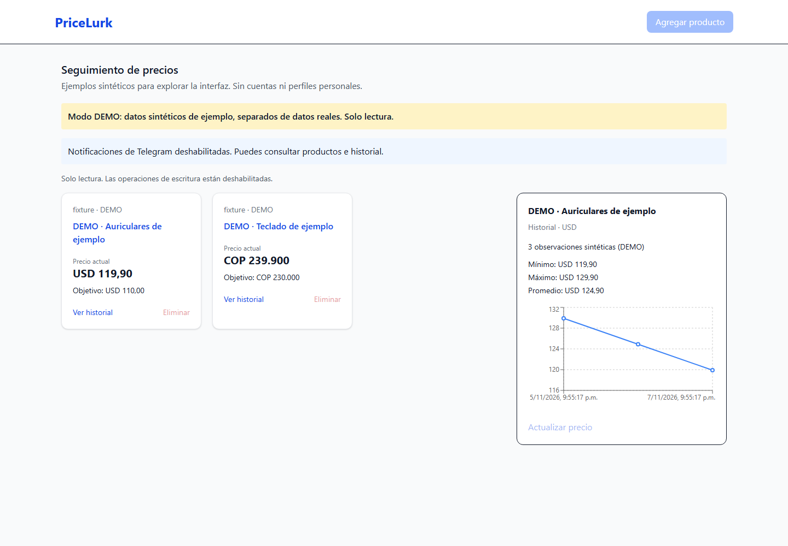

# PriceLurk

Seguimiento de precios para una persona o un entorno de confianza: registra un producto, consulta observaciones de precio y recibe una alerta de Telegram cuando alcanza el objetivo. Proyecto preparado para revisión de BYOP; no implica aceptación del programa, usuarios activos ni resultados comerciales.

## Alcance y estado

- API para agregar, listar, actualizar, consultar historial y desactivar productos. Eliminar conserva el historial.
- Programación con Celery Beat, Redis y un worker que consume una cola configurable. Cada producto usa su propia sesión/transacción; un fallo no interrumpe los demás.
- Importes decimales y monedas explícitas: USD, EUR, COP (dos decimales) y JPY (sin fracciones). La moneda del objetivo debe coincidir con la observada; no hay conversión de divisas.
- Extracción conservadora de un único `Product`/`Offer` JSON-LD o pares de metadatos `product:price`/`og:price`. No se deduce moneda del dominio, símbolo `$`, ubicación ni preferencia del usuario.
- Dominios admitidos: `amazon.com`, `amazon.es`, `mercadolibre.com.co`, `aliexpress.com` y sus subdominios. **La compatibilidad está probada con fixtures, no con consultas a tiendas en vivo.** Captchas, variantes, varios vendedores, precios solo visuales o datos sin moneda explícita pueden impedir una observación.
- Historial con una fila por observación real; una sola observación se dibuja como un punto. Los registros antiguos sin procedencia verificable se conservan y se excluyen de la gráfica y estadísticas.
- Alertas opcionales, acotadas y deduplicadas por episodio de precio bajo. La ausencia de Telegram se comunica en la interfaz y no impide usar productos e historial.
- Interfaz con estados independientes de carga, vacío y error; los mensajes públicos no contienen excepciones internas.

No hay cuentas, registro, recuperación de contraseñas ni separación entre usuarios. `User` es un modelo heredado sin rutas, que se conserva para no destruir esquemas existentes. No se recopilan nuevos datos personales. La lista de productos es compartida y sus lecturas no están autenticadas: no publiques información privada. La API arranca **sin escritura** si `WRITE_API_KEY` está vacía. Para uso privado configura una clave y escríbela en el campo de la interfaz; se mantiene en memoria, no en almacenamiento del navegador. No pongas la clave en variables `VITE_*` ni en el código.

Una demo pública debe usar modo demo de solo lectura o una base revisada sin datos privados y sin clave de escritura distribuida a visitantes. CORS limita orígenes de navegador, pero no sustituye autorización. No es una aplicación multiusuario lista para producción.

## Arquitectura

```text
React + Vite ── HTTP /api/v1 ── FastAPI ── SQLAlchemy ── SQLite / PostgreSQL
                                  │
Celery Beat ── Redis / cola ── Celery worker ── transporte de red validado
                                  │                    │
                                  └── Telegram         └── tiendas admitidas
```

Python 3.14, FastAPI, SQLAlchemy, aiohttp, Celery y Playwright opcional en backend. Node 24, React 19, TypeScript, Vite 8, Tailwind y Recharts en frontend. Las dependencias Python están fijadas en `backend/requirements.txt`; `npm ci` usa `frontend/package-lock.json`. Las imágenes Docker fijan familias de runtime; no se afirma reproducibilidad binaria de imágenes con etiquetas actualizables.

## Inicio con Docker Compose

Instala Docker con Compose y arranca su motor. Desde la raíz:

```powershell
Copy-Item .env.example .env
docker compose up --build -d
docker compose ps
```

En macOS/Linux: `cp .env.example .env`. Por defecto no se necesitan credenciales de Telegram ni de base de datos y la interfaz es de solo lectura hasta configurar una clave local.

Servicios: interfaz en <http://localhost:5173>, API en <http://localhost:8000>, Swagger en <http://localhost:8000/docs>. Redis usa `6379` solo en la red interna de Compose. API y frontend se publican únicamente en loopback; no cambies a una dirección pública sin revisar el alcance anterior. `migrate` prepara el esquema antes de API/worker/Beat. Los datos SQLite viven en el volumen `data`; Redis y el calendario de Beat también persisten. Ejecuta un solo Beat y comienza con un worker/concurrencia uno.

```powershell
docker compose logs --tail=50 api worker beat
docker compose exec worker celery -A app.workers.celery_app:celery_app inspect registered
docker compose down
```

`down` conserva volúmenes. No uses `down -v` si quieres conservar datos. Las capturas o el seeding de demo nunca se ejecutan automáticamente al iniciar.

Para habilitar escritura privada, genera una clave local y guárdala en `WRITE_API_KEY` dentro de `.env`, sin publicarla:

```powershell
python -c "import secrets; print(secrets.token_urlsafe(32))"
docker compose up -d
```

La clave protege **todas** las rutas POST/DELETE. El frontend la envía en `X-API-Key`. Usa HTTPS si accedes fuera de tu equipo; no compartas esta clave en una demo.

### PostgreSQL opcional

SQLite es la opción inicial; no es obligatorio instalar PostgreSQL. Para PostgreSQL configura en `.env` un `POSTGRES_PASSWORD` aleatorio compatible con URL (por ejemplo, generado con `token_urlsafe`). Luego:

```powershell
docker compose -f compose.yml -f compose.postgres.yml up --build -d
```

El overlay configura **la misma URL** `postgresql+psycopg2://...` en migración, API, worker y Beat, crea PostgreSQL 17 y usa el volumen `postgres-data`. Las URLs heredadas `postgresql://` y `postgres://` se normalizan al driver instalado. No importa automáticamente los datos de SQLite. Para cambiar de motor conservando datos se necesita una exportación/importación revisada; no copies simplemente el archivo SQLite ni apuntes los procesos a bases diferentes.

## Instalación nativa

Python 3.14 y Node 24; Redis accesible en `REDIS_URL`. En Windows, Celery se ofrece con `--pool=solo` para desarrollo; para ejecución estable se recomienda Linux/Compose.

```powershell
cd backend
python -m venv .venv
.venv/Scripts/python -m pip install -r requirements.txt
Copy-Item .env.example .env
.venv/Scripts/python -m app.db.migrate
.venv/Scripts/python -m uvicorn app.main:app --host 127.0.0.1 --port 8000
```

En POSIX usa `.venv/bin/python`, `cp` y los mismos módulos. No es necesario activar el entorno si usas estas rutas. Ejecuta los procesos Python desde `backend` para que lean su `.env`. En otra terminal:

```powershell
cd frontend
Copy-Item .env.example .env
npm ci
npm run dev -- --host 127.0.0.1
```

Redis puede ejecutarse sin puerto público mediante Compose; para procesos nativos publica solo loopback si necesitas conectarte desde el host, por ejemplo `docker run --rm -p 127.0.0.1:6379:6379 redis:7-alpine`. Inicia worker y Beat en dos terminales desde `backend` (ajusta `-Q` si cambias la cola):

```powershell
.venv/Scripts/celery -A app.workers.celery_app:celery_app worker --pool=solo --concurrency=1 -Q main-queue --loglevel=info
.venv/Scripts/celery -A app.workers.celery_app:celery_app beat --loglevel=info
```

En Linux puedes omitir `--pool=solo`. Beat solo publica tareas: el worker debe estar vivo y consumir la misma cola. El intervalo mínimo configurable es 60 segundos y el predeterminado es una hora.

### Chromium

La extracción HTTP no necesita navegador. El fallback de navegador está deshabilitado por defecto. Para activarlo configura `BROWSER_FALLBACK=true` e instala el Chromium correspondiente al paquete Python:

```powershell
cd backend
.venv/Scripts/python -m playwright install chromium
```

En Linux usa `python -m playwright install --with-deps chromium` con los permisos adecuados para dependencias del sistema. Docker ya incluye esa instalación. El scraper exige además el sandbox del sistema operativo: si el kernel/política del contenedor no lo permite, el fallback falla de forma cerrada. La instalación de Chromium no demuestra disponibilidad de ese sandbox. En Docker Desktop de esta revisión no estuvo disponible; conserva el fallback deshabilitado hasta configurar un entorno que lo soporte sin quitar el sandbox ni dar privilegios generales al contenedor. La extracción HTTP sigue funcionando. Las pruebas frontend usan su propio paquete Playwright: desde `frontend`, ejecuta `npx playwright install chromium` (o `--with-deps` en Linux).

## Variables

| Variable | Predeterminado / uso |
| --- | --- |
| `DATABASE_URL` | Nativo: `sqlite:///./pricelurk.db`. Compose: `sqlite:////data/pricelurk.db`. PostgreSQL: URL SQLAlchemy del servidor privado. |
| `REDIS_URL` | Nativo: `redis://localhost:6379/0`; Compose usa `redis`. |
| `WRITE_API_KEY` | Vacía = solo lectura. Nunca se publica en el bundle. |
| `CORS_ORIGINS` | Lista JSON de orígenes exactos, por defecto localhost/127.0.0.1 puerto 5173. |
| `CELERY_QUEUE` | `main-queue`; también debe pasarse al worker con `-Q`. Compose lo hace automáticamente. |
| `MONITOR_INTERVAL_SECONDS` | `3600`, mínimo `60`. |
| `TELEGRAM_BOT_TOKEN`, `TELEGRAM_CHAT_ID` | Ambas deben estar configuradas; vacías deshabilitan notificaciones. |
| `TELEGRAM_TIMEOUT`, `TELEGRAM_ATTEMPTS` | Nativo: 5 segundos por intento, hasta 3 intentos; máximos 15 segundos y 3 intentos. |
| `BROWSER_FALLBACK` | `false`; consultas opcionales con Chromium y controles de red comunes. |
| `ENVIRONMENT` | `development`; `production` rechaza modo demo. |
| `DEMO_MODE` | `false`; requiere base separada cuyo nombre contenga `demo`. |
| `VITE_API_BASE_URL` | Frontend: `http://localhost:8000/api/v1`. Incluye `/api/v1`; es pública y se incorpora durante el build. Para mismo origen: `/api/v1`. |

Los ejemplos contienen valores vacíos o placeholders. Reinicia los servicios tras cambiar variables; reconstruye frontend si cambia `VITE_API_BASE_URL`.

## Red, precios y alertas

Las URLs se analizan con un parser, no por palabras sueltas. Se rechazan esquemas distintos de HTTP(S), credenciales, puertos no estándar y hosts fuera de la lista. El resolver que entrega las direcciones **al conector real** rechaza toda respuesta DNS que incluya IP no global, IPv4 mapeada o túneles IPv6. Se conservan el hostname y la comprobación TLS; no hay proxies ambientales ni una segunda resolución sin validar. Cada redirección se valida antes del siguiente acceso (máximo tres); cada descarga tiene timeout total de 20 segundos, solicitudes de 10 segundos, DNS de 4 segundos y un máximo de 2 MiB. Se solicita codificación `identity` y se rechazan respuestas comprimidas antes de leerlas para evitar expansiones de memoria sin límite.

Chromium usa interceptación a nivel de contexto; las peticiones secundarias también pasan por ese transporte, nunca por `route.continue_()`. Solo permite GET de documento/script/XHR/fetch/CSS dentro de la lista. Se bloquean imágenes, descargas, service workers, WebSockets y recursos no admitidos; un proxy sin salida bloquea rutas de red del navegador fuera de la interceptación. Límites: 24 peticiones, 4 MiB de recursos, 30 segundos de navegador y 55 segundos para el scraping completo. Estos controles reducen superficie, pero no sustituyen aislamiento de red del host al procesar páginas hostiles. El fallback no evade captchas ni garantiza compatibilidad con recursos en CDN ajenos a la lista.

SQLite persiste importes nuevos como texto decimal exacto; PostgreSQL usa `NUMERIC(20,4)`. La API exige `target_price` como string decimal (por ejemplo, `"10.10"`) y devuelve strings decimales; la estadística se calcula con `Decimal` y se redondea a la precisión de la moneda. Las etiquetas conservan enteros y centavos con `BigInt` y texto decimal, sin convertir el importe a float. Solo las coordenadas de la gráfica usan números de JavaScript; no calculan estadísticas ni deciden alertas. No se cargan imágenes remotas del producto en el navegador de los visitantes.

Una alerta se reclama mediante actualización condicional en la base **antes** del envío. Mientras el precio siga bajo el objetivo no se reclama otra; una observación por encima lo rearma. Los errores de conexión y respuestas 429 permiten hasta tres intentos con espera de hasta dos segundos. Un timeout tras enviar puede haber entregado el mensaje: se registra `unknown` y no se reintenta. Estados `failed`/`unknown` no se reenvían en el mismo episodio. No se promete entrega exactamente una vez: una caída entre reclamar y enviar puede perder una notificación. Telegram no está activado en modo demo.

### Migración de instalaciones existentes

Detén API, worker y Beat, haz una copia de seguridad privada y ejecuta `python -m app.db.migrate` desde `backend` con la URL correcta. La migración es idempotente y no borra filas. Renombra los campos flotantes anteriores a `legacy_*`, los conserva para auditoría y crea los campos decimales. Marca productos e historial como `legacy_unverified`, deja `currency` y `target_currency` en NULL y no adivina monedas. En PostgreSQL la copia decimal usa la escala del esquema; los valores originales siguen en `legacy_*`.

La primera actualización válida da al precio actual su moneda observada y crea una observación real. **No** asigna una moneda al objetivo antiguo ni reclasifica historial antiguo: ese historial podría contener puntos sintéticos que el código anterior permitía insertar. Para un objetivo nuevo, vuelve a agregar el producto con precio y moneda explícitos; desactiva el anterior cuando hayas revisado sus datos. La base original ya no se distribuye en nuevos checkouts. Si la tienes de una revisión anterior, respáldala y migra en su lugar; las copias locales no se eliminan. La migración prepara esquemas, no mueve datos entre motores.

## Demo explícita

No existe una ruta HTTP para insertar historial aleatorio. El seeding es un comando local con fixtures fijos, rotulados y separado de los datos reales. Desde `backend`, en una terminal de desarrollo independiente:

```powershell
$env:DEMO_MODE='true'
$env:DATABASE_URL='sqlite:///./pricelurk-demo.db'
.venv/Scripts/python -m app.db.demo
.venv/Scripts/python -m uvicorn app.main:app --host 127.0.0.1 --port 8000
```

En POSIX exporta esas variables. No ejecutes simultáneamente otra API en el mismo puerto. La demo rechaza escrituras aunque se configure una clave, no consulta tiendas ni envía Telegram y muestra un aviso visible. Cierra esa terminal o quita las variables para volver al modo real. `ENVIRONMENT=production` con demo provoca un error de configuración.

Captura real de la interfaz ejecutada con **fixtures sintéticos explícitos**; no representa precios de comercios:



[Ver captura móvil](docs/screenshots/demo-mobile.png).

## Pruebas

```powershell
cd backend
.venv/Scripts/python -m pip check
.venv/Scripts/ruff check app tests
.venv/Scripts/python -m pytest --cov=app --cov-fail-under=80 -q
cd ../frontend
npm ci
npm run lint
npm run build
npx playwright install chromium
npm test
```

Las pruebas backend bloquean DNS/red no simulada, usan SQLite temporal y mocks para tiendas y Telegram. Incluyen ejecución de Chromium contra HTML simulado; en Linux esa prueba se marca como omitida únicamente si el host rechaza expresamente el sandbox, sin desactivarlo para hacerla pasar. Las pruebas de rutas y recursos siguen ejecutándose. Las pruebas frontend ejecutan Chromium real con API simulada: carga, vacío, fallo de conexión, demo de solo lectura y flujo agregar/listar/historial/actualizar/eliminar. No envían mensajes ni acceden a tiendas reales. Los workflows usan Python 3.14 y Node 24, con cobertura mínima backend del 80%.

En Windows, detén Vite antes de reinstalar con `npm ci`: el proceso abierto puede bloquear la DLL nativa de Tailwind y producir `EPERM`. No hace falta elevar permisos para resolver ese bloqueo de archivo.

Desde la raíz: `backend/.venv/Scripts/python scripts/audit_secrets.py`. Revisa el reporte redactado de `detect-secrets`, que escanea el árbol actual y todas las revisiones alcanzables sin verificar candidatos por red. El análisis automatizado no garantiza ausencia de secretos. Si aparece una credencial real, informa solo ubicación/tipo y solicita al titular rotación/revocación; este proceso no reescribe historial ni revoca credenciales.

Consulta [VALIDATION.md](docs/VALIDATION.md) para resultados, capturas y límites de lo efectivamente verificado, y [ROADMAP.md](ROADMAP.md) para pendientes e issues.

## Vercel y publicación

`vercel.json` conserva el enfoque de servicios frontend/backend y se ajusta a la [configuración oficial](https://vercel.com/docs/services/config-reference) y a [rutas de servicios](https://vercel.com/docs/services/routing): ASGI `app.main:app` y destinos `{ "service": "backend" }`. Las rutas `/api/...` llegan a FastAPI sin quitar el prefijo. Para ese escenario configura `VITE_API_BASE_URL=/api/v1` antes de construir.

La documentación oficial distingue [servicios HTTP y procesos continuos](https://vercel.com/docs/services). El archivo no aprovisiona Redis, base persistente, migración, worker ni Beat; esos procesos necesitan un entorno persistente definido y comprobado. SQLite local no debe asumirse almacenamiento durable de un servicio hospedado. El push de `85d5eb4` activó una Preview automática de la integración existente: su check informó finalización y GitHub la registra con `production_environment=false`. No se ordenó un despliegue manual ni se verificó el flujo funcional de esa Preview; no se afirma funcionamiento completo en Vercel. Antes de autorizar producción hacen falta elegir alojamiento/almacenamiento, ejecutar la migración y verificar rutas, recursos, restricciones de acceso y monitorización en ese entorno. Esta tarea no despliega a producción ni envía formularios BYOP. El [PR #4](https://github.com/julianvillalba688/pricelurk-app/pull/4) conserva los resultados remotos y sus bloqueos administrativos.

## Licencia y procedencia

El código propio se distribuye con [MIT](LICENSE), por autorización del titular del repositorio. El historial original se conserva; sus cuatro commits iniciales tienen el mismo autor Git. No se encontraron cabeceras de código de terceros con licencia incompatible en la revisión del árbol de aplicación. Esto no demuestra titularidad exclusiva ni relaciones o ausencia de relaciones con empleadores, universidad o clientes.

Las dependencias conservan sus licencias; véase [THIRD_PARTY.md](docs/THIRD_PARTY.md). Se retiró un PNG de adorno sin uso ni procedencia documentada; no se le atribuye una licencia nueva. Los HTML de tiendas y la SQLite anterior se retiraron del árbol distribuido y siguen en el historial, que no se ha reescrito. No se redistribuyen nuevos HTML de tiendas ni datos personales. Las capturas son de la interfaz ejecutada y, cuando muestran productos, están rotuladas como demo sintética.
